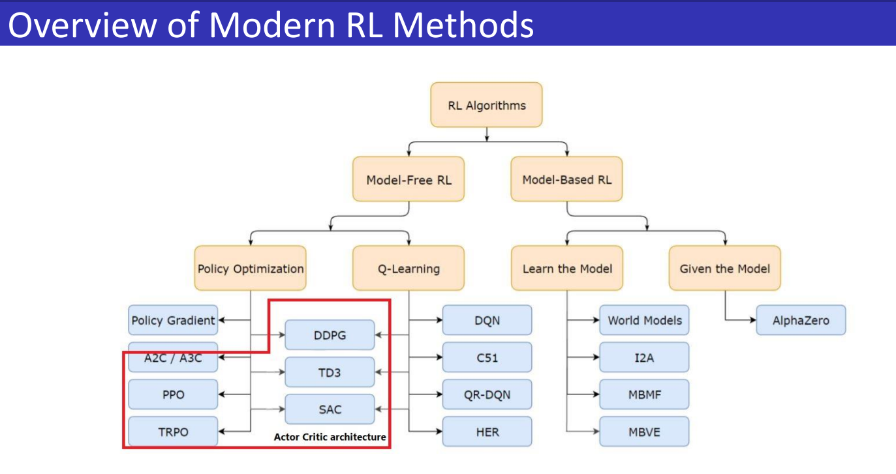

# Reinforcement Learning — Coursework

Assignments from three reinforcement learning courses, from tabular methods to
deep and offline RL. Notebooks are committed with their outputs.

## 1402-2 · Dr. Rohban

| Folder | Topic |
|---|---|
| [`HW1`](1402-2-rohban/HW1) | Theory assignment and its solution (PDF) |
| [`HW2`](1402-2-rohban/HW2) | Monte Carlo and TD control; a DQN agent with replay memory |
| [`HW3`](1402-2-rohban/HW3) | On-policy methods: REINFORCE and PPO |
| [`HW4`](1402-2-rohban/HW4) | Offline RL: online vs. offline SAC, behavioural cloning |

The course syllabus is in [`1402-2-rohban`](1402-2-rohban).

## 1401-2 · Dr. Rohban (Sharif)

The previous offering of the same course: assignment notebooks and PDFs
(HW0–HW4: tabular methods, CartPole, PPO vs. DDPG, MCTS and Thompson
sampling, soft actor-critic), each with the published reference solutions.
The `*_98102176` solutions are by Alireza Gargoori.

## 1399-2 · Dr. Golestani

| File | Topic |
|---|---|
| [`HW1`](1399-2-golestani/HW1.ipynb) | Policy iteration on a grid world |
| [`HW2`](1399-2-golestani/HW2.ipynb) | Exploration: ε-greedy vs. softmax, zero vs. optimistic initialisation |
| [`HW3`](1399-2-golestani/HW3.ipynb) | Deep Q-learning on Atari |

Each notebook also has an `.html` export.

## Large files

Lecture slides, my annotated lecture notes, exam papers and the textbooks
(Sutton & Barto, Berkeley CS 285 slides) are on Google Drive under
`reinforcement-learning-coursework/`, not in git.
